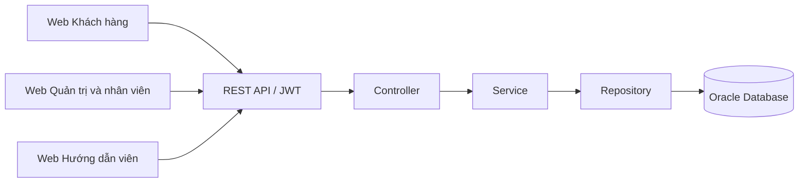

<div align="center">

# 🌏 Digital Travel ERP

### Hệ thống quản lý vận hành du lịch số

**Đồ án môn Nhập môn Công nghệ phần mềm · SE104.R13**<br>
Trường Đại học Công nghệ Thông tin · ĐHQG TP. Hồ Chí Minh


[Giới thiệu](#giới-thiệu) · [Chức năng](#chức-năng-chính) · [Công nghệ](#công-nghệ-sử-dụng) · [Kiến trúc](#kiến-trúc-hệ-thống) · [Cài đặt](#cài-đặt-và-chạy-dự-án) · [Thành viên](#thành-viên-nhóm)

</div>

---

## Thông tin đồ án

| Nội dung | Thông tin |
|---|---|
| Đề tài | Xây dựng hệ thống quản lý vận hành du lịch số |
| Môn học | SE104 — Nhập môn Công nghệ phần mềm |
| Lớp | SE104.R13 |
| Nhóm | 31 |
| Giảng viên hướng dẫn | TS. Nguyễn Thị Xuân Hương |
| Repository | [DigitalTravelERP_SE104](https://github.com/tienlelttt/DigitalTravelERP_SE104) |
| Giai đoạn | Thiết kế và xây dựng hệ thống |

## Giới thiệu

**Digital Travel ERP** là hệ thống quản lý dành cho doanh nghiệp lữ hành, kết nối khách hàng, nhân viên văn phòng và hướng dẫn viên trong cùng một quy trình nghiệp vụ. Hệ thống được thiết kế để quản lý xuyên suốt từ xây dựng sản phẩm tour, tiếp nhận đơn đặt, thanh toán, điều phối nhân sự đến vận hành đoàn và quyết toán tài chính.

Đồ án tập trung vào ba mục tiêu:

- **Quản lý tập trung:** liên kết thông tin tour, khách hàng, nhân sự và giao dịch, hạn chế việc nhập liệu rời rạc giữa các bộ phận.
- **Hỗ trợ vận hành:** theo dõi lịch công tác, phân công hướng dẫn viên, điểm danh, sự cố và chi phí phát sinh theo từng chuyến.
- **Nâng cao trải nghiệm:** cung cấp hồ sơ số, lịch sử hành trình và chương trình điểm xanh gắn với hoạt động du lịch bền vững.

Phạm vi thiết kế gồm **68 use case**, được tổ chức thành các phân hệ nghiệp vụ. Tiến độ triển khai và nghiệm thu được quản lý riêng theo từng yêu cầu.

### Ba cổng giao diện

| Cổng | Người sử dụng | Trọng tâm |
|---|---|---|
| **Khách hàng** | Khách du lịch | Tìm tour, đặt dịch vụ, thanh toán và quản lý hành trình |
| **Quản trị & nghiệp vụ** | Quản trị viên, Sản phẩm, Kinh doanh, Điều hành, Kế toán | Quản lý tài nguyên, giao dịch, nhân sự và tài chính |
| **Hướng dẫn viên** | HDV được phân công | Lịch công tác, danh sách đoàn, điểm danh, sự cố và chi phí |

---

## Chức năng chính

### Khách hàng

- Đăng ký, đăng nhập, quản lý mật khẩu và hồ sơ cá nhân.
- Tìm kiếm, lọc và xem chi tiết tour, lịch trình, dịch vụ bổ sung.
- Đặt tour cho bản thân và người đồng hành; áp dụng voucher, theo dõi thanh toán.
- Xem đơn hàng, yêu cầu hủy tour, theo dõi hoàn tiền và lịch sử hành trình.
- Quản lý hộ chiếu số, điểm xanh, hạng thành viên và ví voucher.
- Gửi đánh giá, khiếu nại và yêu cầu hỗ trợ.

### Quản trị và nhân viên nghiệp vụ

- **Quản trị:** quản lý tài khoản, khóa/mở khóa, phân quyền và nhật ký hệ thống.
- **Sản phẩm:** quản lý tour mẫu, lịch trình, dịch vụ, hành động xanh và thông tin sản phẩm.
- **Điều hành:** khởi tạo tour thực tế, quản lý trạng thái chuyến, tra cứu năng lực/lịch rảnh và phân công HDV.
- **Kinh doanh:** tra cứu khách hàng, xử lý đơn đặt, đối soát thanh toán, yêu cầu hủy, hỗ trợ và chương trình ưu đãi.
- **Kế toán:** duyệt chi phí, theo dõi hoàn tiền, tính doanh thu/lợi nhuận, quyết toán và xuất dữ liệu báo cáo.

### Hướng dẫn viên

- Xem lịch công tác, tour được phân công và phản hồi nhận/từ chối phân công.
- Tra cứu lịch trình, danh sách đoàn và thông tin cần thiết phục vụ chuyến đi.
- Điểm danh khách hàng, xác nhận hành động xanh.
- Ghi nhận và cập nhật sự cố; gửi thông tin giải trình khi có yêu cầu.
- Kê khai chi phí thực tế, đính kèm chứng từ và bổ sung theo phản hồi của kế toán.

### Xử lý tự động và báo cáo

- Điều chỉnh giá bán theo quy tắc định giá động.
- Xử lý đơn quá hạn, hiệu lực voucher và các chuyển trạng thái theo thời gian.
- Tổng hợp doanh thu, chi phí và lợi nhuận theo tour/khoảng thời gian.
- Xuất Excel/CSV và cung cấp dữ liệu phục vụ phân tích bằng Power BI.

## Công nghệ sử dụng

| Thành phần | Công nghệ |
|---|---|
| Backend | Java 21, Spring Boot, Maven |
| API | REST API, Spring Web, Jakarta Bean Validation |
| Xác thực và phân quyền | Spring Security, JWT, BCrypt |
| Truy cập dữ liệu | Spring Data JPA, Hibernate, Oracle JDBC |
| Cơ sở dữ liệu | Oracle Database; SQL, PL/SQL |
| Frontend | React, TypeScript, Vite, Tailwind CSS |
| Kết nối và điều hướng | Axios, React Router |
| Thống kê và xuất dữ liệu | Recharts, Apache POI, OpenCSV, Power BI |
| Tài liệu và kiểm thử API | OpenAPI/Swagger, Postman |
| Kiểm thử backend | JUnit, Mockito, Spring Boot Test |
| Quản lý phát triển | Git, GitHub Issues, Pull Requests |

## Kiến trúc hệ thống

Hệ thống gồm ba ứng dụng web sử dụng chung backend và cơ sở dữ liệu:



Backend phân tách lớp tiếp nhận yêu cầu, xử lý nghiệp vụ và truy cập dữ liệu. DTO xác định dữ liệu trao đổi với frontend; transaction và ràng buộc Oracle bảo đảm tính nhất quán của đơn hàng, quỹ chỗ, voucher và giao dịch.

## Cấu trúc dự án

Cấu trúc thống nhất để triển khai dự án:

<details>
<summary><b>Xem cấu trúc thư mục</b></summary>

```text
DigitalTravelERP_SE104/
├── backend/                         # REST API Java Spring Boot
│   ├── .mvn/                        # Maven Wrapper
│   ├── src/main/java/com/digitaltravel/erp/
│   │   ├── config/                  # Security, JWT và cấu hình ứng dụng
│   │   ├── controller/              # Các nhóm API
│   │   ├── dto/                     # Request và response
│   │   ├── entity/                  # Ánh xạ dữ liệu Oracle
│   │   ├── repository/              # Truy vấn dữ liệu
│   │   ├── service/                 # Xử lý nghiệp vụ
│   │   └── exception/               # Xử lý lỗi tập trung
│   ├── src/main/resources/          # Cấu hình và tài nguyên
│   ├── src/test/                    # Unit test và integration test
│   ├── mvnw.cmd
│   └── pom.xml
├── frontend/
│   ├── admin/                       # Quản trị và nhân viên nghiệp vụ
│   ├── hdv/                         # Hướng dẫn viên
│   └── kh/                          # Khách hàng
├── database/
│   ├── ddl/                         # Bảng, ràng buộc và các đối tượng PL/SQL
│   ├── seed/                        # Dữ liệu mẫu phục vụ phát triển
│   └── checks/                      # SQL kiểm tra tính toàn vẹn
├── docs/                            # Yêu cầu, thiết kế, kiểm thử và báo cáo
└── README.md
```

</details>

## Cài đặt và chạy dự án

> Hướng dẫn bên dưới xác định môi trường và quy ước chạy cho dự án đang xây dựng. Các lệnh áp dụng khi mã nguồn và script khởi tạo tương ứng đã được bổ sung vào repository.

<details>
<summary><b>Thiết lập môi trường và chạy toàn bộ hệ thống</b></summary>

### 1. Yêu cầu môi trường

- **Git** để quản lý mã nguồn.
- **JDK 21** và biến môi trường `JAVA_HOME`.
- **Node.js 22.12+**, npm; phiên bản dependency được chốt bằng lockfile.
- **Oracle Database** cùng schema riêng dành cho phát triển.
- **SQL Developer**, SQLcl hoặc công cụ tương đương để chạy SQL/PLSQL.

### 2. Clone repository

```powershell
git clone https://github.com/tienlelttt/DigitalTravelERP_SE104.git
cd DigitalTravelERP_SE104
```

### 3. Cấu hình backend và cơ sở dữ liệu

Tạo file `backend/.env` theo cấu hình môi trường của dự án:

```dotenv
DB_HOST=localhost
DB_PORT=1521
DB_SERVICE=XEPDB1
DB_USERNAME=digital_travel
DB_PASSWORD=your_local_password
JWT_SECRET=your_random_base64_secret
JWT_EXPIRATION=86400000
SERVER_PORT=8080
PAYMENT_MOCK_ENABLED=false
```

`DB_SERVICE` và thông tin đăng nhập phải khớp schema Oracle trên máy. Khóa JWT cần được sinh ngẫu nhiên cho từng môi trường. Backend sẽ được cấu hình đọc các biến này từ môi trường chạy hoặc file `.env`.

Khởi tạo các đối tượng trong `database/ddl/`, sau đó nạp `database/seed/` và chạy kiểm tra trong `database/checks/` theo thứ tự được mô tả cùng các script. Dùng schema phát triển riêng; đọc kỹ các lệnh xóa/tạo lại dữ liệu trước khi thực thi.

### 4. Chạy backend

Tại thư mục gốc repository:

```powershell
cd backend
.\mvnw.cmd spring-boot:run
```

| Dịch vụ | Địa chỉ cục bộ |
|---|---|
| Backend API | `http://localhost:8080` |
| Swagger UI | `http://localhost:8080/swagger-ui/index.html` |
| OpenAPI | `http://localhost:8080/v3/api-docs` |

### 5. Chạy frontend

Mở terminal riêng cho từng ứng dụng, bắt đầu từ thư mục gốc repository:

**Web quản trị và nhân viên**

```powershell
cd frontend/admin
npm ci
npm run dev -- --port 5173 --strictPort
```

**Web hướng dẫn viên**

```powershell
cd frontend/hdv
npm ci
npm run dev -- --port 5174 --strictPort
```

**Web khách hàng**

```powershell
cd frontend/kh
npm ci
npm run dev -- --port 5175 --strictPort
```

Quy ước tích hợp: frontend gọi API qua prefix `/api`; Vite proxy chuyển yêu cầu tới backend tại `http://localhost:8080`. Khi thay đổi cổng backend cần cập nhật cấu hình proxy tương ứng.

</details>

## Kiểm thử và build

**Backend** — chạy trong `backend/`:

```powershell
.\mvnw.cmd test
.\mvnw.cmd clean package
```

Integration test liên quan đến dữ liệu cần schema Oracle kiểm thử riêng và cấu hình phù hợp.

**Frontend** — chạy trong từng ứng dụng `admin`, `hdv`, `kh`:

```powershell
npm run lint
npm run build
```

Các nhóm kiểm thử trọng tâm gồm xác thực/phân quyền, quyền sở hữu dữ liệu, đặt tour đồng thời, voucher, thanh toán lặp, hủy/hoàn tiền, phân công HDV, điểm danh, duyệt chi phí và khóa dữ liệu sau quyết toán. Kết quả kiểm thử được ghi nhận theo từng phiên bản.

Thanh toán mô phỏng chỉ được bật trên môi trường demo bằng `PAYMENT_MOCK_ENABLED=true`; không đại diện cho tích hợp cổng thanh toán thực tế.

## Thành viên nhóm

<p align="center">
  <a href="https://github.com/tienlelttt"></a>
  &nbsp;
  <a href="https://github.com/ThorBietBay001"></a>
  &nbsp;
  <a href="https://github.com/NgKthy"></a>
  &nbsp;
  <a href="https://github.com/Yuu2006"></a>
  &nbsp;
  <a href="https://github.com/thanhtri271206"></a>
</p>

| STT | MSSV | Họ và tên | Vai trò chính | GitHub |
|:---:|---|---|---|---|
| 1 | 24521769 | **Lê Thị Thanh Tiền** | **Trưởng nhóm** · FE Khách hàng & HDV · API | [tienlelttt](https://github.com/tienlelttt) |
| 2 | 24521817 | Đoàn Thị Thùy Trang | FE Quản trị & nghiệp vụ · API | [ThorBietBay001](https://github.com/ThorBietBay001) |
| 3 | 24521776 | Nguyễn Trần Thủy Tiên | Thiết kế & phát triển CSDL Oracle | [NgKthy](https://github.com/NgKthy) |
| 4 | 24522039 | Nguyễn Tuấn Vũ | Backend · Nền tảng & giao dịch | [Yuu2006](https://github.com/Yuu2006) |
| 5 | 24521825 | Bùi Phan Thành Trí | Backend · Vận hành & tài chính | [thanhtri271206](https://github.com/thanhtri271206) |

## Tài liệu dự án

Tài liệu yêu cầu, use case, thiết kế hệ thống, cơ sở dữ liệu, kiểm thử và báo cáo môn học được tổ chức trong thư mục `docs/` theo từng giai đoạn phát triển.
